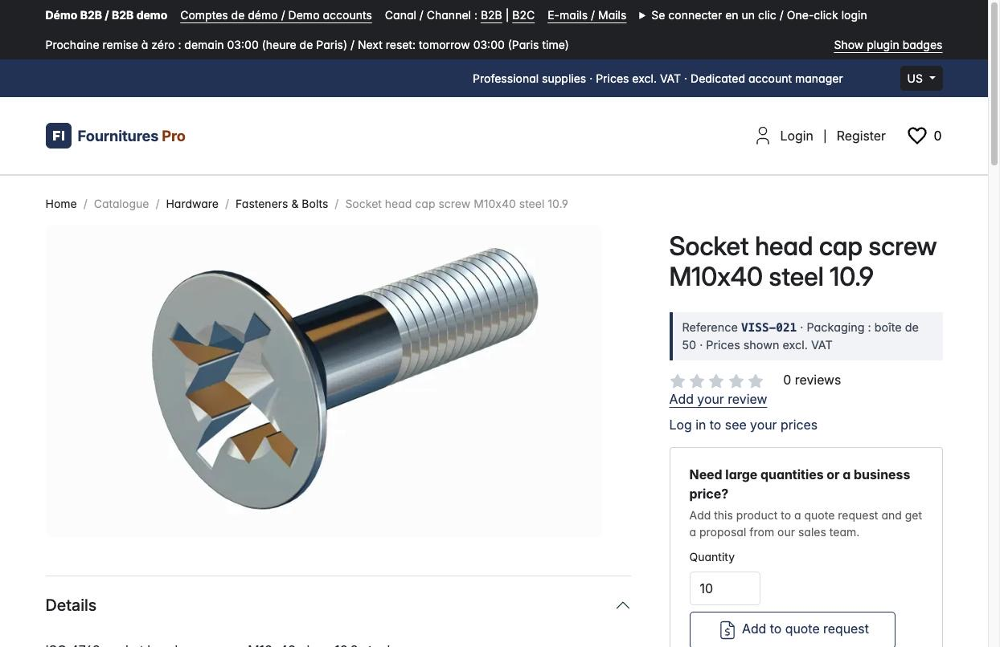
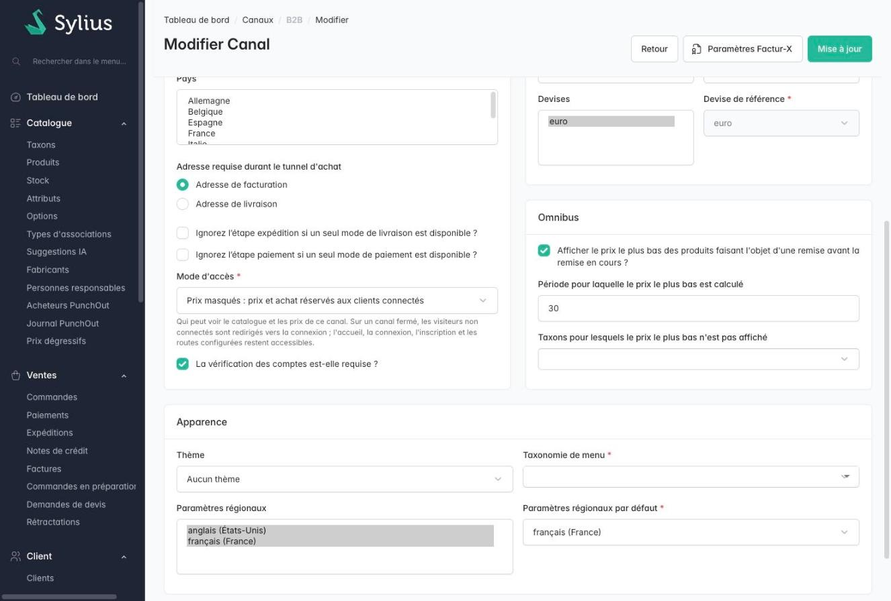

# Sylius Channel Access Plugin

> English: [README.md](README.md) <!-- vitrine:lang -->

[](https://github.com/thibmonier/sylius-channel-access-plugin/actions/workflows/build.yaml)
[](LICENSE)

**Choisissez, canal par canal, si les visiteurs non connectés voient le catalogue, les prix et le
bouton d'achat : ouvert, prix masqués, ou fermé derrière une connexion.**

Une boutique B2B a souvent besoin d'un mur de connexion (rien pour les visiteurs anonymes) ou d'un
catalogue sans prix tant que le client ne s'est pas connecté. Masquer un prix dans un template ne suffit
pas : le même prix est dans l'API de la boutique, et l'ajout au panier fonctionne quoi que la page affiche.
Ce plugin applique le mode côté serveur.

## Fonctionnalités

| Mode | Visiteur anonyme | Client connecté |
|---|---|---|
| `open` (par défaut) | Tout, comme Sylius | Tout |
| `prices_hidden` | Pages du catalogue ; **ni prix, ni promotion, ni bouton d'achat** (remplacés par un lien « Connectez-vous pour voir vos prix »), pas de mini-panier ; les routes du panier, du tunnel de commande et des commandes redirigent vers la connexion ; l'API de la boutique ne renvoie aucun prix et refuse les paniers | Tout |
| `closed` | **Uniquement la page d'accueil, la connexion, l'inscription, la réinitialisation du mot de passe et les routes que vous exemptez** ; tout le reste redirige vers la connexion (401 JSON sur `/api/v2/shop/*`) ; ni prix, ni produit, ni menu de taxons, même sur la page d'accueil et la connexion | Tout |

Également : un champ dans le formulaire de canal de l'administration (valeur invalide refusée, mode
précédent conservé) ; les réponses d'un canal restreint sont `private, no-store` (aucun cache partagé
ne mélange les visiteurs) ; une protection de dernier recours sur l'order modifier refuse tout ajout au
panier d'un visiteur anonyme d'un canal qui masque les prix (pages de la boutique, live components, API
de la boutique, nouvelle commande à l'identique) ; une valeur stockée inconnue est lue comme `closed` ; traductions en anglais,
français, allemand, espagnol, italien, néerlandais et polonais ; MySQL, MariaDB et PostgreSQL (migration
via la Schema API).

## Captures d'écran



*Fiche produit d'un visiteur anonyme sur un canal « prix masqués » : « Log in to see your prices » remplace le prix et le bouton d'achat*



*Champ « Mode d'accès » du formulaire de canal : ouvert, prix masqués ou fermé*

## Prérequis

| | Version |
|---|---|
| PHP | 8.3+ |
| Sylius | 2.3 (le plugin s'appuie sur l'option `condition` des twig hooks, absente de Sylius 2.2) |
| Symfony | 6.4, 7.4, 8.0 |

## Installation

1. Installez le paquet :

    ```bash
    composer require tmonier/sylius-channel-access-plugin
    ```

2. Enregistrez le bundle dans `config/bundles.php` :

    ```php
    Tmonier\SyliusChannelAccessPlugin\TmonierSyliusChannelAccessPlugin::class => ['all' => true],
    ```

3. Ajoutez le trait à l'entité canal de votre application (le plugin ne modifie à lui seul aucune
   entité Sylius) :

    ```php
    use Doctrine\ORM\Mapping as ORM;
    use Sylius\Component\Core\Model\Channel as BaseChannel;
    use Tmonier\SyliusChannelAccessPlugin\Entity\Channel\AccessModeAwareInterface;
    use Tmonier\SyliusChannelAccessPlugin\Entity\Channel\AccessModeTrait;

    #[ORM\Entity]
    #[ORM\Table(name: 'sylius_channel')]
    class Channel extends BaseChannel implements AccessModeAwareInterface
    {
        use AccessModeTrait;
    }
    ```

   et déclarez-la (`config/packages/_sylius.yaml`) :

    ```yaml
    sylius_channel:
        resources:
            channel:
                classes:
                    model: App\Entity\Channel\Channel
    ```

   Une classe de canal sans le trait est traitée comme **fermée** (et une erreur est journalisée) : le
   plugin refuse plutôt que d'ouvrir silencieusement tout.

4. Importez les hooks (prix, bouton d'achat et champ d'administration) dans `config/packages/_sylius.yaml` :

    ```yaml
    imports:
        - { resource: "@TmonierSyliusChannelAccessPlugin/config/config.yaml" }
    ```

5. Exécutez la migration (une colonne `sylius_channel.access_mode`, `open` par défaut ; les canaux existants
   restent ouverts) :

    ```bash
    bin/console doctrine:migrations:migrate
    ```

6. Choisissez le mode dans l'administration : *Canaux > modifier > Mode d'accès*.

## Configuration

Facultative (`config/packages/tmonier_sylius_channel_access.yaml`) :

```yaml
tmonier_sylius_channel_access:
    login_route: sylius_shop_login      # where a closed channel sends anonymous visitors ("_locale" parameter)
    exempt_routes: ['app_mcp_*']        # shell-style patterns on the route name
    exempt_paths: ['/punchout/*', '/feeds/*']   # shell-style patterns on the path
    restricted_routes: ['app_quote_*']          # refused without access to the prices (see below)
    restricted_paths: ['%sylius.security.api_shop_route%/product-variants/*/tier-prices']
```

Un visiteur anonyme d'un canal **fermé** n'atteint que :

- la liste d'autorisation intégrée : la page d'accueil (`sylius_shop_homepage`), les sélecteurs de locale et de
  devise, la connexion, la déconnexion, l'inscription, la vérification de l'e-mail, la réinitialisation du mot de passe ; l'administration
  (`/admin`, et `/api/v2/admin/*` qui a son propre firewall) ; les endpoints de connexion, d'inscription,
  de réinitialisation du mot de passe et de vérification de l'API de la boutique ; le profiler et les pages d'erreur ;
- les routes et chemins que **vous** listez. Entrées typiques : PunchOut (`/punchout/*` ou les noms de
  routes), un endpoint MCP, des flux produits, un health check. Elles sont en général authentifiées par
  autre chose (jeton, basic auth) : le plugin cesse seulement de les refuser.

Les motifs utilisent `*` pour n'importe quels caractères, `/` compris (`/feeds/*` correspond à `/feeds/a/b.xml`, pas
à `/feedsx`). Un motif qui correspondrait à toutes les requêtes (`*`, `/*`...) est refusé à la construction
du conteneur. Un chemin contenant `..`, `//` ou un octet NUL ne correspond jamais à un motif de chemin (la
requête est refusée comme tout chemin non listé). **Tout ce qui n'est pas listé est refusé**, y compris les
chemins inconnus (pas de page 404 qui montrerait le menu du catalogue).

### Restreindre davantage de routes (`restricted_routes`, `restricted_paths`)

Sur un canal aux **prix masqués**, un visiteur anonyme se voit refuser le panier, le tunnel de commande, les commandes et
les commandes de l'API de la boutique. D'autres plugins ajoutent des routes qui affichent des prix ou construisent un document chiffré ; listez-les
avec les mêmes motifs que les exemptions (noms de routes avec `*`, chemins avec `*`, paramètres `%parameter%`
résolus par le conteneur). Elles sont fusionnées avec celles qui sont intégrées et refusées comme le
panier : redirection vers la connexion pour les pages, 401 JSON sous l'API de la boutique. Exemples : le formulaire de demande de
devis (`tmonier_quote_request_shop_new`, `tmonier_quote_request_shop_basket_add`), la commande rapide
(`tmonier_quick_order_shop_add`), le consentement aux assistants IA (`tmonier_b2b_mcp_shop_*`), l'API des prix
dégressifs (`.../product-variants/*/tier-prices`). Sur un canal **fermé**, tout ce qui n'est pas exempté est déjà
refusé, ces options ne comptent donc que pour les canaux aux prix masqués. Une valeur vide ou qui n'est pas une chaîne
est une erreur de configuration qui nomme l'option. Une route ou un chemin présent à la fois dans `exempt_*` et dans
`restricted_*` (y compris ceux qui sont intégrés) fait échouer la compilation du conteneur avec un message qui le nomme ;
la comparaison porte sur les valeurs résolues et couvre une entrée qui en inclut une autre (par exemple
`exempt_paths: /api/v2/shop/*` face à la restriction intégrée `.../orders`), dans les deux sens, en nommant les deux
entrées. **Une restriction l'emporte sur une exemption** (refus avant autorisation) pour les recouvrements que cette comparaison ne peut pas voir
(deux motifs génériques qui se croisent) : le côté sûr d'une erreur est une route refusée, pas une route ouverte.

Préférez les **noms de routes** aux chemins : un motif de chemin doit deviner toutes les écritures de l'URL (suffixe de format tel que
`.json` / `.jsonld`, slash final, préfixe de locale), un nom de route est ce que le routeur a reconnu. La restriction intégrée de
l'API couvre `orders`, `orders/*` et `orders.*` ; pour votre propre chemin d'API, ajoutez les variantes (`.../tier-prices*`).
Un chemin auquel on ne peut pas se fier (`..`, `//`, une barre oblique inverse, un octet NUL) est traité comme **restreint** par le
matcher de restriction (échec fermé) et ne correspond jamais à une exemption.

La redirection va toujours vers `login_route` ; aucun paramètre de requête ni en-tête de la requête ne choisit
la cible (pas de redirection ouverte). La locale de l'URL de connexion est celle de la requête quand le canal
la propose, sinon la locale par défaut du canal.

## Contrat pour les autres plugins

Figé pour la 0.x (`Tmonier\SyliusChannelAccessPlugin\Access`) :

```php
enum AccessMode: string { case Open = 'open'; case PricesHidden = 'prices_hidden'; case Closed = 'closed'; }

interface AccessModeResolverInterface
{
    public function modeOf(ChannelInterface $channel): AccessMode;
    public function currentMode(): AccessMode;      // channel of the current HTTP request; Open without request, Closed without channel
    public function isVisitorSignedIn(): bool;      // the token holds a Sylius user (customer or administrator)
    public function canSeeCatalog(): bool;          // false: anonymous visitor of a closed channel
    public function canSeePrices(): bool;           // false: anonymous visitor of a channel that is not open
}
```

Le service est `tmonier_channel_access.resolver` (alias sur l'interface). Twig :
`tmonier_channel_access_mode()`, `tmonier_channel_can_see_prices()`,
`tmonier_channel_can_see_catalog()`. Attributs de sécurité pour `is_granted()` et les conditions de hooks :
`TMONIER_CHANNEL_ACCESS_SEE_PRICES`, `TMONIER_CHANNEL_ACCESS_SEE_CATALOG`. Un plugin qui affiche des prix ailleurs (un formulaire de commande
rapide, une liste de prix) interroge le resolver, ou met la même condition sur son hookable.

Points d'extension (utilisés par `tmonier/sylius-registration-approval-plugin`) : décorez le service
`tmonier_channel_access.resolver` pour changer ce qui compte comme connecté (toutes les protections suivent), et
appelez `VisitorAccessListener::refusalFor(Request): ?Response` (service
`tmonier_channel_access.listener.visitor_access`) pour savoir si un visiteur anonyme serait
refusé pour une requête, et avec quelle réponse.

## Fonctionnement et limites

- Le catalogue (listes de produits de la page d'accueil, menu des taxons et hamburger de chaque page, pages d'erreur comprises) est masqué aux visiteurs anonymes d'un canal **fermé** par le même mécanisme, avec l'attribut `TMONIER_CHANNEL_ACCESS_SEE_CATALOG`.
- Les prix des pages de la boutique sont masqués par des **conditions sur les hookables Sylius** (page produit :
  `prices`, `catalog_promotions`, `add_to_cart` ; carte produit : `prices` ; en-tête et off-canvas :
  `cart`). Un thème ou un plugin qui affiche des prix ailleurs doit utiliser la même condition.
- Le normalizer de variante de l'API de la boutique est enveloppé : `price`, `originalPrice`,
  `lowestPriceBeforeDiscount` et `appliedPromotions` sont retirés pour les visiteurs anonymes d'un
  canal qui n'est pas ouvert. Les autres sources de prix (ressources personnalisées) ne sont pas couvertes.
- Le tri de la liste par prix fonctionne toujours pour un visiteur anonyme sur un canal aux prix masqués
  (l'ordre des produits est visible, pas les montants).
- Les fichiers statiques (`/media`, `/build`) sont servis par le serveur web et ne sont pas protégés.
- Un canal restreint répond `Cache-Control: private, no-store` et `Vary: Cookie, Authorization`.
  Une route exemptée qui rend sa réponse `public` volontairement conserve ses en-têtes.
- Sur un canal fermé, une URL inconnue redirige vers la connexion même pour un client connecté : le routeur rejette le chemin avant que le firewall ne s'exécute, le visiteur est donc encore inconnu.
- Les commandes console et les handlers de messages n'ont pas de requête HTTP : ils ne sont jamais restreints.
- L'administration et l'API d'administration ne sont jamais restreintes par ce plugin.

## Tests

Voir `CLAUDE.md` pour les commandes. Les tests fonctionnels pilotent la vraie boutique et la vraie API et vérifient le
comportement rendu (redirections, absence de prix dans les pages et le JSON, ajout au panier refusé, routes
exemptées, entrées forgées).

<!-- vitrine:demo-b2b:start -->
## Démo B2B

Ce plugin est utilisé dans la [démo B2B Sylius](https://github.com/thibmonier/sylius-b2b-demo) : une boutique Sylius 2.3 avec des données d'exemple fictives, où les plugins B2B fonctionnent ensemble. Le code source, l'installation et les fixtures de la démo sont dans ce dépôt.

- Démo en ligne : [sylius-b2b.thibaut-monier.fr](https://sylius-b2b.thibaut-monier.fr)
- Auteur : [Thibaut Monier](https://www.linkedin.com/in/thibautmonier/)

La démo est un exemple, pas une configuration de production.
<!-- vitrine:demo-b2b:end -->

## Licence

MIT, voir [LICENSE](LICENSE).
